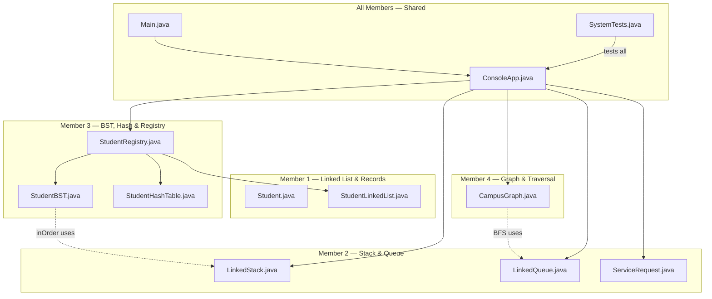

# Team Member Responsibility Breakdown

## Project: University Student Record and Campus Route Management System

---

## Member 1 — Linked List Implementation & Student Record Management

**Core Data Structure:** Singly Linked List

### Primary Files

| File | Path | Lines | Description |
|------|------|-------|-------------|
| [`Student.java`](file:///c:/Users/Nilupul%20Madhusanka/Desktop/new/University%20Student%20Record%20and%20Campus%20Route%20Management%20System/src/university/Student.java) | `src/university/` | 47 | Immutable student model with ID normalization, validation, and getters |
| [`StudentLinkedList.java`](file:///c:/Users/Nilupul%20Madhusanka/Desktop/new/University%20Student%20Record%20and%20Campus%20Route%20Management%20System/src/university/StudentLinkedList.java) | `src/university/` | 80 | Singly linked list — `add()`, `replace()`, `remove()`, `iterator()` |

### Responsibilities
- **`Student.java`** — The shared data model. Member 1 owns this because the linked list is the primary record store and every CRUD operation starts here.
  - `normalizeId()` — uppercase ID normalization with regex validation
  - `requireText()` — blank-field validation (reused across the entire project)
  - Constructor validation (marks 0–100, finite check)
- **`StudentLinkedList.java`** — Custom singly linked list with inner `Node` class
  - Maintains insertion order (head/tail pointers)
  - `add()` — appends to tail
  - `replace()` — in-place update by ID
  - `remove()` — unlinks node, updates head/tail
  - Implements `Iterable<Student>` for for-each traversal

### Menu Options Covered
- **Option 1** — Add Student Record
- **Option 2** — Update Student Record
- **Option 3** — Delete Student Record
- **Option 4** — Display All Records using Linked List

---

## Member 2 — Stack & Queue Implementation and Related Operations

**Core Data Structures:** Linked Stack (LIFO) + Linked Queue (FIFO)

### Primary Files

| File | Path | Lines | Description |
|------|------|-------|-------------|
| [`LinkedStack.java`](file:///c:/Users/Nilupul%20Madhusanka/Desktop/new/University%20Student%20Record%20and%20Campus%20Route%20Management%20System/src/university/LinkedStack.java) | `src/university/` | 53 | Generic LIFO stack — `push()`, `pop()`, `peek()`, `iterator()` |
| [`LinkedQueue.java`](file:///c:/Users/Nilupul%20Madhusanka/Desktop/new/University%20Student%20Record%20and%20Campus%20Route%20Management%20System/src/university/LinkedQueue.java) | `src/university/` | 46 | Generic FIFO queue — `enqueue()`, `dequeue()`, `peek()` |
| [`ServiceRequest.java`](file:///c:/Users/Nilupul%20Madhusanka/Desktop/new/University%20Student%20Record%20and%20Campus%20Route%20Management%20System/src/university/ServiceRequest.java) | `src/university/` | 26 | Service request model — stores request number, student snapshot, description |

### Responsibilities
- **`LinkedStack<T>`** — Generic stack with inner `Node<T>` class
  - `push()` — prepends new node
  - `pop()` / `peek()` — LIFO access with `NoSuchElementException` on empty
  - Implements `Iterable<T>` — non-destructive iteration (newest → oldest)
  - Used in `ConsoleApp` as `history` (action log) and in `StudentBST.inOrder()` for iterative traversal
- **`LinkedQueue<T>`** — Generic queue with front/rear pointers
  - `enqueue()` — adds to rear
  - `dequeue()` — removes from front, resets rear when empty
  - Used in `ConsoleApp` as `requests` (service request queue) and in `CampusGraph.breadthFirstTraversal()` for BFS
- **`ServiceRequest.java`** — Immutable request model
  - Captures a snapshot of student ID/name at submission time
  - Request numbering, description validation

### Menu Options Covered
- **Option 5** — Add Service Request to Queue
- **Option 6** — Process Next Service Request
- **Option 7** — Display Recent Actions using Stack

---

## Member 3 — BST/AVL Tree Implementation & Hashing/Search Functionality

**Core Data Structures:** Binary Search Tree + Hash Table (separate chaining)

### Primary Files

| File | Path | Lines | Description |
|------|------|-------|-------------|
| [`StudentBST.java`](file:///c:/Users/Nilupul%20Madhusanka/Desktop/new/University%20Student%20Record%20and%20Campus%20Route%20Management%20System/src/university/StudentBST.java) | `src/university/` | 94 | Unbalanced BST keyed by student ID — `put()`, `find()`, `remove()`, `inOrder()` |
| [`StudentHashTable.java`](file:///c:/Users/Nilupul%20Madhusanka/Desktop/new/University%20Student%20Record%20and%20Campus%20Route%20Management%20System/src/university/StudentHashTable.java) | `src/university/` | 78 | Hash table with separate chaining — `get()`, `put()`, `remove()`, auto-resize |
| [`StudentRegistry.java`](file:///c:/Users/Nilupul%20Madhusanka/Desktop/new/University%20Student%20Record%20and%20Campus%20Route%20Management%20System/src/university/StudentRegistry.java) | `src/university/` | 58 | Façade that keeps all 3 structures (list + BST + hash) in sync |

### Responsibilities
- **`StudentBST.java`** — Binary Search Tree with inner `Node` class
  - `put()` — iterative insert/update by ID comparison
  - `find()` — iterative search
  - `remove()` — handles 3 cases (leaf, one child, two children with in-order successor)
  - `inOrder()` — iterative traversal using `LinkedStack` (avoids stack overflow on skewed trees)
- **`StudentHashTable.java`** — Hash table with separate chaining
  - `Entry` inner class forms linked chains per bucket
  - `put()` — insert or update, triggers `resize()` when load factor > 0.75
  - `get()` — lookup by normalized ID
  - `remove()` — unlinks entry from chain
  - `resize()` — doubles capacity and rehashes all entries
- **`StudentRegistry.java`** — Coordination façade
  - `add()` / `update()` / `delete()` — keeps `StudentLinkedList`, `StudentBST`, and `StudentHashTable` consistent
  - `searchByHash()` / `searchByTree()` — dual lookup paths
  - `insertionOrder()` — delegates to list
  - `sortedById()` — delegates to BST's `inOrder()`

### Menu Options Covered
- **Option 8** — Display Students using BST (sorted by ID)
- **Option 9** — Search Student using Hashing

> [!NOTE]
> `StudentRegistry.java` is assigned to Member 3 because it primarily exists to coordinate BST + Hash Table with the linked list. Member 3 will need to collaborate with Member 1 since the registry wraps the linked list too.

---

## Member 4 — Graph Implementation, Campus Locations, Connections & BFS/DFS Traversal

**Core Data Structure:** Undirected unweighted graph (adjacency list)

### Primary Files

| File | Path | Lines | Description |
|------|------|-------|-------------|
| [`CampusGraph.java`](file:///c:/Users/Nilupul%20Madhusanka/Desktop/new/University%20Student%20Record%20and%20Campus%20Route%20Management%20System/src/university/CampusGraph.java) | `src/university/` | 104 | Adjacency-list graph — locations, connections, BFS traversal |

### Responsibilities
- **`CampusGraph.java`** — Graph with inner `Location` class
  - `Location` — stores name + `LinkedHashSet<String>` of neighbour keys
  - `addLocation()` / `removeLocation()` — vertex management with case-insensitive normalization
  - `addConnection()` / `removeConnection()` — undirected edge management with self-loop prevention and duplicate detection
  - `adjacencyList()` — returns full adjacency map (display-friendly)
  - `breadthFirstTraversal()` — BFS using `LinkedQueue` (from Member 2's implementation)
  - Uses `LinkedHashMap` / `LinkedHashSet` for deterministic display order

### Menu Options Covered
- **Option 10** — Add Campus Location
- **Option 11** — Remove Campus Location
- **Option 12** — Add Campus Connection/Road
- **Option 13** — Remove Campus Connection/Road
- **Option 14** — Display Campus Connections
- **Option 15** — Traverse Campus Locations using BFS

---

## All Members — Shared/Integration Files

### Shared Files

| File | Path | Lines | Description |
|------|------|-------|-------------|
| [`ConsoleApp.java`](file:///c:/Users/Nilupul%20Madhusanka/Desktop/new/University%20Student%20Record%20and%20Campus%20Route%20Management%20System/src/university/ConsoleApp.java) | `src/university/` | 272 | Console UI — menu, input parsing, orchestrates all data structures |
| [`Main.java`](file:///c:/Users/Nilupul%20Madhusanka/Desktop/new/University%20Student%20Record%20and%20Campus%20Route%20Management%20System/src/university/Main.java) | `src/university/` | 13 | Entry point — wires `System.in`/`System.out` to `ConsoleApp` |
| [`SystemTests.java`](file:///c:/Users/Nilupul%20Madhusanka/Desktop/new/University%20Student%20Record%20and%20Campus%20Route%20Management%20System/tests/university/SystemTests.java) | `tests/university/` | 257 | Comprehensive behavioral tests across all components |
| [`run.bat`](file:///c:/Users/Nilupul%20Madhusanka/Desktop/new/University%20Student%20Record%20and%20Campus%20Route%20Management%20System/run.bat) | root | — | Build and run script |
| [`test.bat`](file:///c:/Users/Nilupul%20Madhusanka/Desktop/new/University%20Student%20Record%20and%20Campus%20Route%20Management%20System/test.bat) | root | — | Build and test script |
| [`README.md`](file:///c:/Users/Nilupul%20Madhusanka/Desktop/new/University%20Student%20Record%20and%20Campus%20Route%20Management%20System/README.md) | root | — | Project documentation |

### Shared Responsibilities
- **Integration** — Connecting individual data structures through `ConsoleApp.java` and `StudentRegistry.java`
- **Validation** — Input validation, edge-case handling
- **Testing** — Writing and maintaining `SystemTests.java` (each member should add tests for their components)
- **Debugging** — Cross-component issues
- **Documentation** — `README.md`, code comments, Javadoc
- **GitHub Collaboration** — Branching, pull requests, merge conflict resolution

---

## Visual Summary

---

## Cross-Dependencies Between Members

| Dependency | From → To | Details |
|------------|-----------|---------|
| `StudentBST.inOrder()` uses `LinkedStack` | Member 3 → Member 2 | Iterative tree traversal relies on the stack |
| `CampusGraph.breadthFirstTraversal()` uses `LinkedQueue` | Member 4 → Member 2 | BFS frontier queue |
| `StudentRegistry` wraps `StudentLinkedList` | Member 3 → Member 1 | Registry keeps the list in sync |
| All structures use `Student.normalizeId()` / `requireText()` | Members 2,3,4 → Member 1 | Shared validation utilities |

> [!IMPORTANT]
> **Member 1** should complete `Student.java` first since all other members depend on it. **Member 2** should complete the stack and queue early since Members 3 and 4 depend on those data structures.
